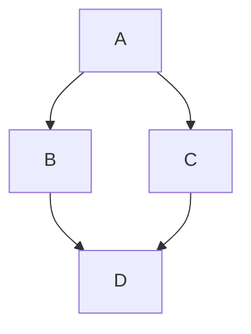

[](https://github.com/ahosking)
[](https://github.com/ahosking)
[](https://github.com/ahosking)

# Don't forget about [mermaid](https://github.blog/2022-02-14-include-diagrams-markdown-files-mermaid/)!


-------

📊 **Weekly development breakdown**

<!--START_SECTION:waka-->

```txt
Markdown     3 hrs 58 mins         ██████████████▓░░░░░░░░░░   58.22 %
Dart         1 hr 8 mins           ████▒░░░░░░░░░░░░░░░░░░░░   16.72 %
Gherkin      41 mins               ██▓░░░░░░░░░░░░░░░░░░░░░░   10.05 %
Bash         31 mins               ██░░░░░░░░░░░░░░░░░░░░░░░   07.79 %
Other        11 mins               ▓░░░░░░░░░░░░░░░░░░░░░░░░   02.74 %
```

<!--END_SECTION:waka-->
